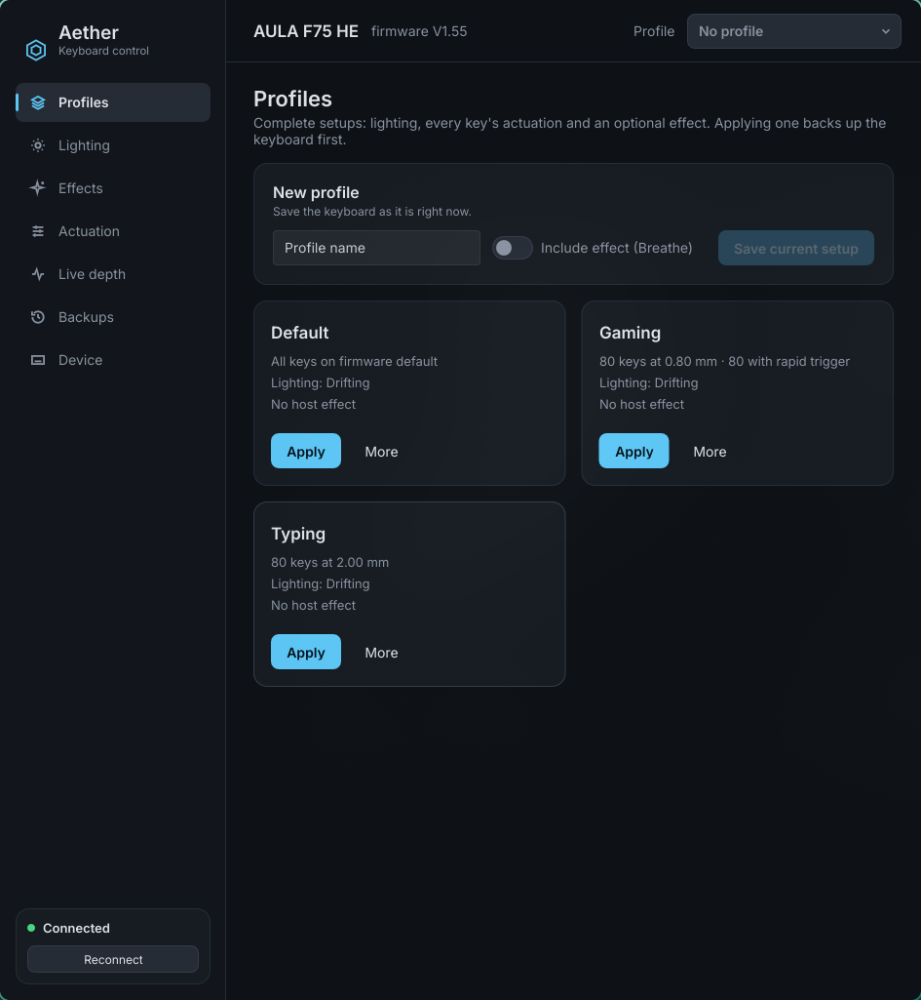
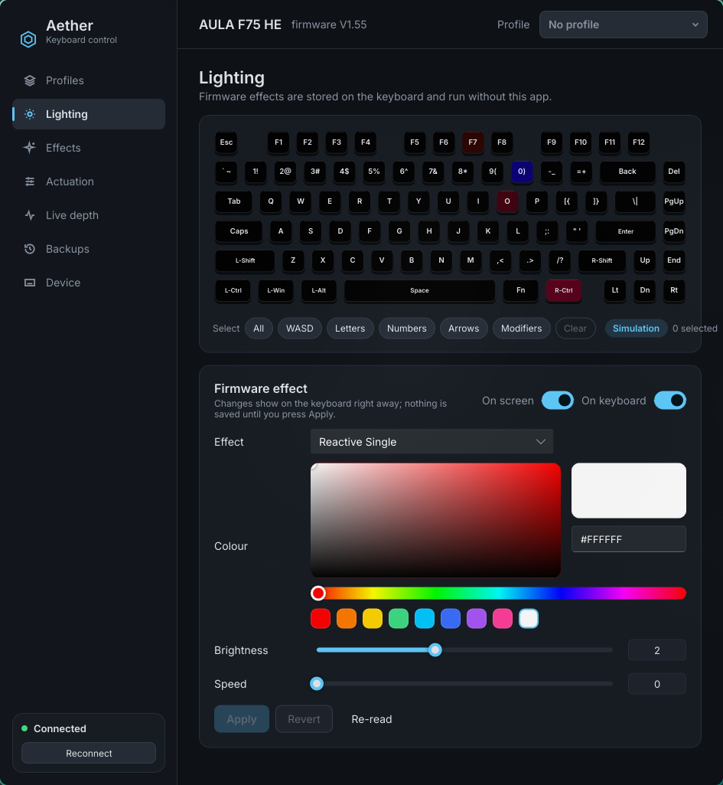
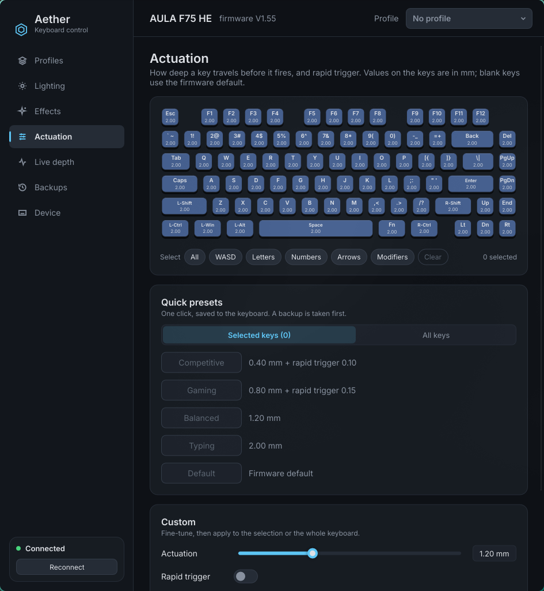

# Aether HE

**A fast, native Linux control app for the AULA F75 HE Hall-effect keyboard, written in Rust.**

Profiles, firmware lighting with live preview, animated per-key effects, actuation and rapid trigger,
with an automatic backup before every change.

`Rust` · `Linux (Wayland / X11)` · `AULA F75 HE — hardware-verified`



| Lighting: live preview + colour picker | Actuation: presets, rapid trigger |
|---|---|
|  |  |

---

## Features

- **Profiles:** save your whole setup (lighting, every key's actuation, optionally an effect) and switch
  between them in one click. Default, Gaming and Typing are created for you.
- **Firmware lighting:** all 19 built-in effects, with brightness, speed and an HSV colour picker.
  - **Live preview:** every change shows on the keyboard immediately, and nothing is saved until you
    press *Apply*.
  - **On-screen simulation:** the virtual keyboard animates a look-alike of the selected effect.
- **Host effects:** wave, breathe, aurora, comet, tide, twinkle, rain, striation and static, with your
  own palette, streamed to every key at ~28 fps while the app is open.
- **Actuation and rapid trigger:**
  - Per key, from 0.10 to 3.40 mm.
  - One-click presets: Competitive, Gaming, Balanced, Typing, Default.
  - *All keys* or a selection, chosen by clicking, Shift+click, a drag box, or shortcuts like WASD.
  - Reset to the factory default.
- **Safety first:**
  - A backup is taken automatically before every change.
  - Every actuation write is verified by reading the keyboard back.
  - *Restore original* returns the keyboard to how it was before Aether touched it.
- **CLI:** everything scriptable with the `aether` command.

## Supported keyboard

| Keyboard | USB ID | Status |
|---|---|---|
| AULA F75 HE (wired, USB-C) | `38A6:2729` | ✅ lighting · host effects · actuation · rapid trigger |

**Not supported (yet):**
- key remapping, macros, SOCD, dead zones,
- calibration,
- the 2.4 GHz dongle,
- live key-depth display (the keyboard doesn't expose it safely).

---

## Install

### 1. Requirements
Linux with a graphical session. Tested on CachyOS / Arch with Wayland (Hyprland). On Arch-based
systems:

```bash
sudo pacman -S --needed rust hidapi pkgconf
```

`scripts/build.sh` checks for these and prints the exact command if something is missing.

### 2. Get the code and install

```bash
git clone https://github.com/xpLayA/aether-he.git
cd aether-he
./scripts/install.sh
```

**What `install.sh` does:**
1. Builds the release binaries. The first build takes a few minutes.
2. Installs `aether-gui` and `aether` to `~/.local/bin`, and their data to `~/.local/share/aether-he`.
3. Adds **Aether HE** to your app menu, with an icon.
4. Asks for your password **once**, to install a udev rule (`/etc/udev/rules.d/70-aether.rules`). The
   rule lets your user talk to the keyboard without `sudo`.
5. Records everything it installed, so it can be removed cleanly later.

**After installing, unplug and replug the keyboard once.**

| Option | Effect |
|---|---|
| `--prefix DIR` | install somewhere other than `~/.local` |
| `--no-udev` | skip the udev rule (you'll need to install it yourself) |
| `--no-build` | install the existing build as-is |

### 3. Run it
Open **Aether HE** from your app menu, or run:

```bash
aether-gui
```

> Close the official Aula web driver (browser tab) first. While it's open it holds the keyboard.

---

## Using it

**Profiles**
- *Profiles* → **Apply** on a tile, or use the **Profile** switcher at the top right on any page.
- To save your own: type a name under *New profile* and press **Save current setup**. Tick *Include
  effect* to start your current host effect whenever the profile is applied.
- **More** on a tile: update it from the keyboard, attach or remove an effect, rename, duplicate,
  delete.

**Actuation**
- Select keys on the keyboard: click, Shift+click, drag a box, or use *All / WASD / Letters / …*.
- Click a **preset**, or set *Actuation* (and *Rapid trigger* press/release) and **Apply**.
- Switch *Selected keys* to **All keys** to change the whole board at once.
- **Reset selected / Reset all** go back to the firmware default. Keys show their value in mm; blank
  means default.

**Lighting**
- Pick an effect, colour, brightness and speed. With **On keyboard** enabled, the keyboard shows it live.
- **Apply** keeps it. **Cancel preview**, switching page or closing the app puts the old lighting back.
- **On screen** toggles the animated simulation on the virtual keyboard.

**Effects**
- Choose an effect and colours, then **Start effect**.
- Effects run while the app is open, and **Stop** restores your firmware lighting.

**Backups**
- A backup is made before every change.
- **Restore** any of them, or **Restore original** for the pre-Aether state.
- Restoring is verified by reading the keyboard back.

## Command line

```bash
aether info                                   # identity + firmware
aether light get | modes
aether light set --mode static --color ff0000 --brightness 5
aether actuation get [--keys W,A,S,D]
aether actuation set --keys W,A,S,D --travel 0.8 --rt 0.15
aether actuation set --keys all --travel 1.2
aether actuation reset [--keys all]          # back to firmware default
aether profile list | save NAME | apply NAME | delete NAME
aether effect rain --colors 00ff80,0080ff --seconds 30   # Ctrl+C stops, lighting restored
aether backup [--out FILE]
aether backups                                # oldest first
aether restore [FILE] | aether restore --original
```

Every command that changes the keyboard saves a backup first.

---

## Update

```bash
cd aether-he
git pull
./scripts/install.sh
```

## Uninstall

```bash
./scripts/uninstall.sh
```

It lists exactly what will be removed and asks before doing anything. It also asks what to do with the
keyboard:

```
Keyboard settings:
  [k] keep the current lighting and actuation (default)
  [r] restore the original settings, from before Aether first changed them
```

| Option | Effect |
|---|---|
| `--keep-settings` / `--restore-original` | answer the keyboard question in advance |
| `--purge` | also delete your backups and GUI settings (asks again) |
| `--yes` | don't ask (keeps the keyboard settings) |
| `--prefix DIR` | the prefix used at install time |

- Your **backups are kept** unless you pass `--purge`.
- The keyboard stores its own settings, so uninstalling the app doesn't change the keyboard unless you
  choose *restore original*.

---

## Where your data lives

| What | Path |
|---|---|
| Backups (taken automatically) | `~/.local/share/aether-he/backups/` |
| Profiles | `~/.config/aether-he/profiles/` |
| GUI settings | `~/.config/aether-he/gui.json` |
| Installed app data | `~/.local/share/aether-he/data/` |

## Troubleshooting

**"No keyboard connected"**
- Use the USB-C cable. The 2.4 GHz dongle isn't supported.
- Close the Aula web driver tab.
- Make sure the udev rule is installed (`./scripts/install.sh`), then unplug and replug the keyboard.
- Run `aether info` to see the exact error.

**A setting didn't stick:** press **Read** on the Actuation page, or `aether actuation get`, to see what
the keyboard really has. Then restore a backup if needed.

**The window doesn't open:** run `aether-gui` from a terminal to see the error. It needs a working
Wayland or X11 session with OpenGL.

## Safety

Aether only sends commands that have been verified on the F75 HE, and it checks each write by reading
the keyboard back. The vendor protocol's flash, factory-reset and calibration commands **can't even be
expressed** in Aether's protocol code, and a second check refuses them at the USB layer.

---

## Development

```bash
./scripts/build.sh            # dependency check, tests, release build
cargo test --workspace        # protocol golden tests, driver tests (simulated keyboard), effects, GUI helpers
AETHER_PAGE=actuation ./target/release/aether-gui   # open on a page
```

| Crate | What it is |
|---|---|
| `crates/aether-proto` | Wire protocol: frame builders and parsers, no I/O; golden-tested against the original Python implementation |
| `crates/aether-device` | USB transport, keyboard driver, layouts, backups, profiles |
| `crates/aether-effects` | Host-streamed per-key effects |
| `crates/aether-cli` | The `aether` command |
| `crates/aether-gui` | The `aether-gui` desktop app (Slint): `ui/*.slint` for layout, `src/` for logic |

**Other places in the repo:**
- Engineering notes for contributors (and AI assistants): [`CLAUDE.md`](CLAUDE.md).
- Security review of the original code: [`docs/SECURITY_AUDIT.md`](docs/SECURITY_AUDIT.md).
- Protocol research and the original Python app, kept as the reference implementation:
  [`docs/context/`](docs/context/) and [`legacy/python/`](legacy/python/).

## Credits

- Forked from [MrWhosNexus/Aether-HE](https://github.com/MrWhosNexus/Aether-HE) (Python, AULA WIN60 HE).
  Rewritten in Rust and brought up on the F75 HE.
- UI built with [Slint](https://slint.dev) (royalty-free licence; attribution on the Device page).
- [Inter](https://rsms.me/inter/) typeface, SIL Open Font License (`crates/aether-gui/assets/OFL.txt`).
